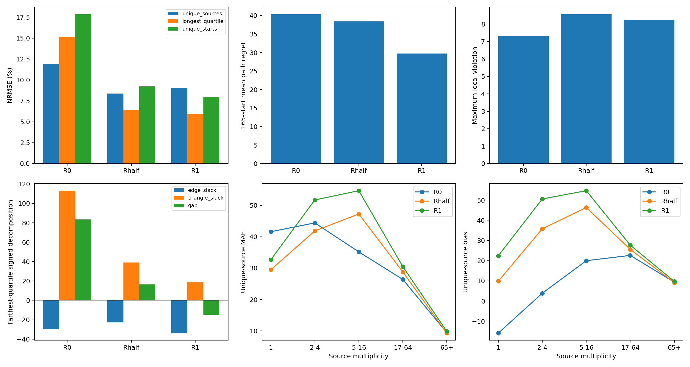

# Rhalf 部分源均衡：R0 / Rhalf / R1（正式50k）

本轮Rhalf的去重源NRMSE为8.3850%，最远四分位为6.4316%，相对R0保留R1远端NRMSE改善幅度的94.85%。去重源bias从R1的+25.5929变为+13.7382，去重边平均正违反从R1的0.214654变为0.169041。但最优分支数为26/58（R0/R1为30/28），最大违反为8.553942（R0/R1为7.308139/8.250990）。

它不是各项指标简单位于两端之间：部分指标优于两端，部分指标劣于两端。对于本轮结果，距离拟合、总体高估与平均违反形成了有利折中，但最坏违反和分支决策没有改善，不能宣布整体更优。

本轮仅新增固定alpha=0.5；task损失为 `-0.6 mean((0.5+0.5 N/(M n(s))) d(s,G))`。这是记录均匀与去重源均匀task经验目标的混合，不是保持目标不变的重采样。B1、PHR、记录采样、dual时钟及全部共同配置保持一致。旧R0/R1直接复用，未重跑或追加seed/预算。

## 协议与验证

seed606，batch256，sampler seed2307，B1 seed42，task_mode=all，4线程，AdamW weight_decay0，逐记录PHR rho100；每访问用primal前残差以eta1更新dual。45k恒定lr2e-5，随后5k从2e-6几何衰减至2e-7。每1000步全量审计，保留epoch末尾40条小批次。所有组从相同零步model/optimizer/zero dual/visits/sampler/RNG/counters开始。

N=42536，M=6766；Rhalf权重范围0.510408–3.643364，全量均值1.0000000112。不做minibatch权重和归一化。

6项训练pytest测试及2项分组分析测试全部通过：alpha端点相对旧源码快照更新一致，half全量值与梯度、B1/PHR/dual公式、全50k采样预算及真实4步训练/恢复和alpha/权重/配置拒绝。源码快照与环境指纹已冻结；运行环境同上轮，旧源码后续多seed支持未改变核心更新函数，本轮仍只用seed606。

三组完整有序采样序列一致，每行访问299–300次，总访问12,735,416次，Rhalf完成51次全量审计（含0步）。R0/R1配置、checkpoint、数据和预算均核验；本次统一重算的R0/R1评价结果与旧报告完全相等。

## 任务距离

bias=预测−参考；NRMSE=RMSE/RMS(参考)。修正参考仅在50k完成后加载。

| 分组 | 模型 | MAE | RMSE | NRMSE % | bias |
|---|---|---:|---:|---:|---:|
| 42,536记录 | R0 | 22.3837 | 32.6570 | 11.1768 | +11.9275 |
| 42,536记录 | Rhalf | 21.8579 | 29.9538 | 10.2516 | +17.8181 |
| 42,536记录 | R1 | 23.5858 | 32.0300 | 10.9622 | +21.0967 |
| 6,766去重源 | R0 | 40.1326 | 54.5342 | 11.9017 | -10.6338 |
| 6,766去重源 | Rhalf | 30.3336 | 38.4205 | 8.3850 | +13.7382 |
| 6,766去重源 | R1 | 34.1096 | 41.3817 | 9.0312 | +25.5929 |
| 最远四分位 | R0 | 83.4675 | 93.3882 | 15.1820 | -83.4597 |
| 最远四分位 | Rhalf | 28.4454 | 39.5623 | 6.4316 | -16.3755 |
| 最远四分位 | R1 | 31.7203 | 36.6391 | 5.9564 | +14.9502 |
| 165独立起点 | R0 | 84.4465 | 100.1222 | 17.8406 | -67.9311 |
| 165独立起点 | Rhalf | 39.2143 | 51.7833 | 9.2272 | -12.2276 |
| 165独立起点 | R1 | 35.1809 | 44.8050 | 7.9837 | +14.1315 |
| 307原始起点 | R0 | 59.5647 | 77.4675 | 16.0950 | -28.3572 |
| 307原始起点 | Rhalf | 36.3354 | 46.3964 | 9.6395 | +7.8156 |
| 307原始起点 | R1 | 36.7256 | 45.2900 | 9.4097 | +25.1165 |

## 分支与完整路径

| 模型 | 最优分支/58 | 严格排序正确率 | 分支平均regret | 165路径平均regret | 165最优路径 | 307路径平均regret |
|---|---:|---:|---:|---:|---:|---:|
| R0 | 30 | 65.0104% | 10.6993 | 40.3047 | 11 | 33.6643 |
| Rhalf | 26 | 67.9089% | 10.9403 | 38.3876 | 7 | 30.3288 |
| R1 | 28 | 68.5300% | 9.3763 | 29.7446 | 8 | 24.9558 |

候选边和cost+预测后继距离贪心规则相同；严格排序排除参考并列，最优容差1e-6。图无环、唯一无出边节点为目标、最长可选路径275步；307/307到达主要由图结构保证，仅为完整性检查。

## 局部违反

残差=d(s,s′)−原始一步成本。违反数使用阈值1e-5；最大/平均正违反为relu残差，不截断容差。

| 模型 | 分布 | 违反数/总数 | 最大正违反 | 平均正违反 |
|---|---|---:|---:|---:|
| R0 | records | 19649/42536 | 7.308139 | 0.060431 |
| R0 | unique_edges | 1646/6958 | 7.308139 | 0.124127 |
| Rhalf | records | 20506/42536 | 8.553942 | 0.077456 |
| Rhalf | unique_edges | 1855/6958 | 8.553942 | 0.169041 |
| R1 | records | 20232/42536 | 8.250990 | 0.095564 |
| R1 | unique_edges | 2081/6958 | 8.250990 | 0.214654 |

## 长程有符号误差分解

`D*−J = Σ(cost−d_edge) + [Σd_edge−J]`，沿固定参考最短路径计算。两项分别是累计边项和累计三角松弛。负边项可掩盖正三角松弛；该恒等式不构成RMSE可加归因或因果中介识别。

| 分组 | 模型 | D*−J | 累计边项 | 累计三角松弛 |
|---|---|---:|---:|---:|
| 42,536记录 | R0 | -11.9275 | -19.6199 | 7.6924 |
| 42,536记录 | Rhalf | -17.8181 | -20.3413 | 2.5232 |
| 42,536记录 | R1 | -21.0967 | -22.7549 | 1.6582 |
| 6,766去重源 | R0 | 10.6338 | -26.1682 | 36.8020 |
| 6,766去重源 | Rhalf | -13.7382 | -25.7361 | 11.9979 |
| 6,766去重源 | R1 | -25.5929 | -31.8933 | 6.3004 |
| 最远四分位 | R0 | 83.4597 | -29.6058 | 113.0655 |
| 最远四分位 | Rhalf | 16.3755 | -22.6668 | 39.0424 |
| 最远四分位 | R1 | -14.9502 | -33.8106 | 18.8604 |
| 165独立起点 | R0 | 67.9311 | -26.7130 | 94.6441 |
| 165独立起点 | Rhalf | 12.2276 | -24.8155 | 37.0431 |
| 165独立起点 | R1 | -14.1315 | -34.9453 | 20.8139 |
| 307原始起点 | R0 | 28.3572 | -28.9883 | 57.3455 |
| 307原始起点 | Rhalf | -7.8156 | -29.5808 | 21.7652 |
| 307原始起点 | R1 | -25.1165 | -37.1855 | 12.0690 |

## 按源重复次数分组

边界在训练前固定，计数来自参与task push的物理行。下面先给每源一次的误差；记录加权结果另列。不同组参考距离分布不同，因此跨组NRMSE不能当成同尺度难度比较；组内三模型的参考尺度相同。

| n(s) | 去重源数 | 记录数 | 组内平均参考 | R0/Rhalf/R1 task目标权重占比 |
|---|---:|---:|---:|---|
| 1 | 5414 | 5414 | 409.5855 | 12.73%/46.37%/80.02% |
| 2-4 | 745 | 1800 | 563.1008 | 4.23%/7.62%/11.01% |
| 5-16 | 23 | 159 | 542.8284 | 0.37%/0.36%/0.34% |
| 17-64 | 411 | 20777 | 256.7690 | 48.85%/27.46%/6.07% |
| 65+ | 173 | 14386 | 94.9643 | 33.82%/18.19%/2.56% |

### 每源等权

| n(s) | 模型 | MAE | RMSE | NRMSE % | bias |
|---|---|---:|---:|---:|---:|
| 1 | R0 | 41.5900 | 57.2114 | 12.4788 | -15.9184 |
| 1 | Rhalf | 29.4693 | 37.8232 | 8.2499 | +9.8167 |
| 1 | R1 | 32.6519 | 39.9491 | 8.7136 | +22.3832 |
| 2-4 | R0 | 44.4056 | 50.5912 | 8.9708 | +3.8523 |
| 2-4 | Rhalf | 41.8430 | 47.1585 | 8.3621 | +35.7799 |
| 2-4 | R1 | 51.7107 | 55.2845 | 9.8030 | +50.5639 |
| 5-16 | R0 | 35.1723 | 40.9796 | 7.5426 | +19.9756 |
| 5-16 | Rhalf | 47.2469 | 52.0515 | 9.5804 | +46.3407 |
| 5-16 | R1 | 54.6666 | 59.2781 | 10.9105 | +54.6666 |
| 17-64 | R0 | 26.3921 | 31.6395 | 10.8489 | +22.6039 |
| 17-64 | Rhalf | 28.7740 | 34.2047 | 11.7285 | +25.5489 |
| 17-64 | R1 | 30.4826 | 36.2593 | 12.4330 | +27.6591 |
| 65+ | R0 | 9.4235 | 15.9940 | 10.7033 | +9.3317 |
| 65+ | Rhalf | 9.2773 | 15.6341 | 10.4625 | +9.1489 |
| 65+ | R1 | 9.8179 | 16.6315 | 11.1300 | +9.7328 |

### 记录加权

| n(s) | 模型 | MAE | RMSE | NRMSE % | bias |
|---|---|---:|---:|---:|---:|
| 1 | R0 | 41.5900 | 57.2114 | 12.4788 | -15.9184 |
| 1 | Rhalf | 29.4693 | 37.8232 | 8.2499 | +9.8167 |
| 1 | R1 | 32.6519 | 39.9491 | 8.7136 | +22.3832 |
| 2-4 | R0 | 43.7515 | 49.7210 | 8.8429 | +6.5199 |
| 2-4 | Rhalf | 42.7088 | 47.8075 | 8.5026 | +37.4747 |
| 2-4 | R1 | 52.6679 | 55.9389 | 9.9487 | +51.6838 |
| 5-16 | R0 | 34.8854 | 40.8734 | 7.5234 | +21.3807 |
| 5-16 | Rhalf | 47.9000 | 52.1413 | 9.5975 | +46.9824 |
| 5-16 | R1 | 54.7215 | 58.7262 | 10.8095 | +54.7215 |
| 17-64 | R0 | 25.0622 | 30.6090 | 11.1020 | +22.0299 |
| 17-64 | Rhalf | 27.2216 | 32.9433 | 11.9487 | +24.6167 |
| 17-64 | R1 | 28.6718 | 34.7177 | 12.5923 | +26.3924 |
| 65+ | R0 | 8.4754 | 15.5108 | 10.7753 | +8.3886 |
| 65+ | Rhalf | 8.3501 | 15.2018 | 10.5606 | +8.2285 |
| 65+ | R1 | 8.8457 | 16.1981 | 11.2528 | +8.7656 |

### 逐源绝对误差的改善与退化

差值=Rhalf绝对误差−对照绝对误差，负为改善；计数容差1e-5。每个源只计一次。

| n(s) | 对照 | 改善源数 | 退化源数 | 近似不变 | 平均MAE差 |
|---|---|---:|---:|---:|---:|
| 1 | R0 | 2932 | 2482 | 0 | -12.1208 |
| 1 | R1 | 3596 | 1818 | 0 | -3.1826 |
| 2-4 | R0 | 234 | 511 | 0 | -2.5626 |
| 2-4 | R1 | 681 | 64 | 0 | -9.8677 |
| 5-16 | R0 | 4 | 19 | 0 | +12.0746 |
| 5-16 | R1 | 23 | 0 | 0 | -7.4197 |
| 17-64 | R0 | 101 | 310 | 0 | +2.3818 |
| 17-64 | R1 | 290 | 121 | 0 | -1.7087 |
| 65+ | R0 | 94 | 79 | 0 | -0.1462 |
| 65+ | R1 | 124 | 49 | 0 | -0.5406 |

## Rhalf的折中判断

相对R0，Rhalf保留R1最远四分位NRMSE改善幅度的 94.85%。该比例仅描述这一指标，不是综合收益或因果归因。

优于两端的指标：去重源NRMSE, 记录MAE。
劣于两端的指标：最优分支数（越多越好）, 分支平均regret, 165起点最优完整路径数（越多越好）, 最大局部违反。
其余所列指标位于两端之间或并列；不能由alpha的线性插值假定训练结果也线性插值。

- 42,536记录：Rhalf NRMSE 10.2516%，相对R0 -0.9252个百分点、相对R1 -0.7106个百分点；MAE 21.8579，bias +17.8181。
- 6,766去重源：Rhalf NRMSE 8.3850%，相对R0 -3.5167个百分点、相对R1 -0.6462个百分点；MAE 30.3336，bias +13.7382。
- 最远四分位：Rhalf NRMSE 6.4316%，相对R0 -8.7504个百分点、相对R1 +0.4752个百分点；MAE 28.4454，bias -16.3755。
- 165独立起点：Rhalf NRMSE 9.2272%，相对R0 -8.6134个百分点、相对R1 +1.2434个百分点；MAE 39.2143，bias -12.2276。
- 相对R0：最优分支数变化 -4，排序正确率变化 +2.8986个百分点，分支平均regret变化 +0.2410，165路径平均regret变化 -1.9171；最大违反变化 +1.245803，去重边平均正违反变化 +0.044914。
- 最远四分位相对R0的有符号gap变化 -67.0842 = 累计边项变化 +6.9390 + 三角松弛变化 -74.0231。
- 相对R1：最优分支数变化 -2，排序正确率变化 -0.6211个百分点，分支平均regret变化 +1.5640，165路径平均regret变化 +8.6430；最大违反变化 +0.302952，去重边平均正违反变化 -0.045612。
- 最远四分位相对R1的有符号gap变化 +31.3258 = 累计边项变化 +11.1438 + 三角松弛变化 +20.1820。

### 改善与退化发生在哪里

- n(s)=1，5414个源：相对R0，组内MAE变化-12.1208，2932个源改善、2482个源退化；相对R1，组内MAE变化-3.1826。
- n(s)=2-4，745个源：相对R0，组内MAE变化-2.5626，234个源改善、511个源退化；相对R1，组内MAE变化-9.8677。
- n(s)=5-16，23个源：相对R0，组内MAE变化+12.0746，4个源改善、19个源退化；相对R1，组内MAE变化-7.4197。
- n(s)=17-64，411个源：相对R0，组内MAE变化+2.3818，101个源改善、310个源退化；相对R1，组内MAE变化-1.7087。
- n(s)=65+，173个源：相对R0，组内MAE变化-0.1462，94个源改善、79个源退化；相对R1，组内MAE变化-0.5406。

合计相对R0：3365个源绝对误差改善，3401个源退化；相对R1：4714改善、2052退化。平均误差下降不意味着大多数或每个状态都改善；尤其组内平均改善与退化源数量可能同时增加。各组规模差异很大，应同时看样本数与误差幅度。

相对R0的远端误差改善伴随累计三角松弛下降，且该组累计边项变得更不负；因此不能把该组改善简单解释为累积了更多局部违反。但局部最大违反和全体平均违反是不同统计量，仍须单独报告。

## 45k仅作事后过程分析

| 模型/步骤 | 去重源NRMSE % | 最远NRMSE % | 最优分支 | 165路径regret | 最大违反 |
|---|---:|---:|---:|---:|---:|
| R0/45000 | 12.8639 | 17.2855 | 31 | 38.9201 | 7.221553 |
| R0/50000 | 11.9017 | 15.1820 | 30 | 40.3047 | 7.308139 |
| Rhalf/45000 | 7.8335 | 7.6593 | 27 | 51.6132 | 8.664814 |
| Rhalf/50000 | 8.3850 | 6.4316 | 26 | 38.3876 | 8.553942 |
| R1/45000 | 7.5064 | 5.3363 | 31 | 29.1463 | 8.316708 |
| R1/50000 | 9.0312 | 5.9564 | 28 | 29.7446 | 8.250990 |

50k始终为正式终点，不挑最好checkpoint。单seed606、4线程、固定有限训练图；不承诺多线程逐位复现，不证明多seed稳定性、连续控制或未见状态泛化。共享后缀下源/记录/路径也不是统计独立样本。本轮未搜索其他alpha、追加预算或新增seed。

命令和实现见 `experiments/task_partial_balance/PROTOCOL.md`；冻结配置 `../protocol.json`，复用核验 `../reuse_verification.json`，测试 `../../tests.log`，完整结果 `summary.json`，分组结果 `multiplicity.json`。

