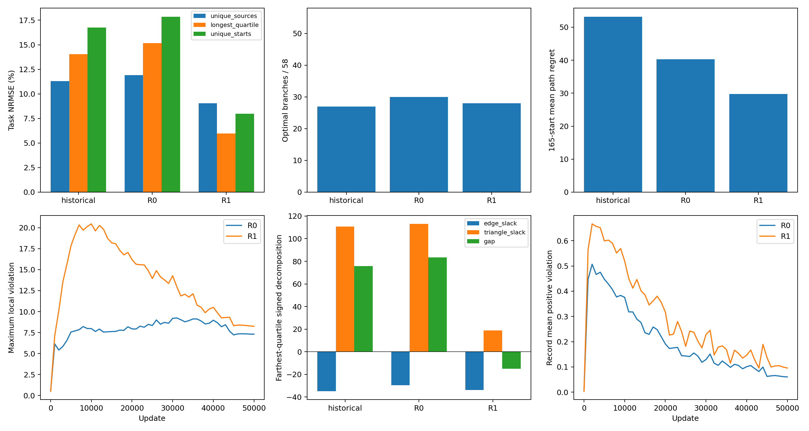

# task push 去重源均衡配对实验（50k 正式终点）

本轮R1的去重源NRMSE为9.03%（R0为11.90%），最远四分位为5.96%（R0为15.18%）。165独立起点平均路径regret为29.74（R0为40.30），但最优分支数为28/58（R0为30/58），最大局部违反为8.25（R0为7.31）。距离、决策与可行性必须分别判断，不能用单一改善指标概括。

本轮仅将 task 的经验目标分布从物理记录均匀改为 canonical 源状态均匀。所有重复记录、轨迹、B1 配对、原始一步成本、PHR 与 dual 时钟均保留。R0/R1 都是从原 initial.pt 对齐的零步状态重新训练，不是任何诊断终点的续训。训练行为按e06e2ad核对，复用与50452ef相同的原训练器；未继承e162dd3或b7c940f的训练改动。完成两组预算后才读取保留eb2967d修正的 `results/connected_reference_fix_20261024/main` 参考。

## 配置、测试与配对核验

配置：seed606，batch256，sampler seed2307，B1 seed42，task_mode=all，AdamW weight decay=0，逐记录 PHR rho100，primal 前残差 eta1 逐访问更新乘子。45k×2e-5，随后5k从2e-6几何下降至2e-7；每组4线程，每1000步全量审计，固定50k。原采样器保留每epoch最后40条的小批次。

加载得到 N=42536、M=6766；平均权重=1.0000000189。全局权重为 N/(M n(s))；minibatch 不除权重和。float32源总权重差异小于6e-7。

初始模型、优化器、零乘子、访问计数、sampler、RNG 和计数器与历史逐项一致。完整有序采样序列已独立重建核验；两组每行访问299–300次，总访问12,735,416次，均完成51次全量审计（含0步）。最终乘子允许独立演化；最终 sampler/visits/RNG/counters 同历史及两组一致。

测试记录见 `../../tests.log` 与 `../../integration_smoke.json`（10项pytest测试及两模式完整恢复烟雾检查）。原始默认训练器未改动；R0 与 e06e2ad 连续更新对照、R1 加权值与梯度、显式 B1/PHR/dual 公式、全50k采样预算以及完整恢复与配置拒绝均通过。

## 任务距离

误差与 bias 均相对修正后的图参考，bias=预测−参考；NRMSE=RMSE/RMS(参考)。records 使用物理记录自然重复权重，unique_sources 每源一次；最远四分位阈值只用于事后评价。

| 分组 | 模型 | MAE | RMSE | NRMSE % | bias |
|---|---|---:|---:|---:|---:|
| 42,536记录 | historical | 22.2538 | 32.0150 | 10.9571 | 12.6776 |
| 42,536记录 | R0 | 22.3837 | 32.6570 | 11.1768 | 11.9275 |
| 42,536记录 | R1 | 23.5858 | 32.0300 | 10.9622 | 21.0967 |
| 6,766去重源 | historical | 38.4099 | 51.7136 | 11.2861 | -7.7911 |
| 6,766去重源 | R0 | 40.1326 | 54.5342 | 11.9017 | -10.6338 |
| 6,766去重源 | R1 | 34.1096 | 41.3817 | 9.0312 | 25.5929 |
| 最远四分位 | historical | 75.7703 | 86.4277 | 14.0505 | -75.7593 |
| 最远四分位 | R0 | 83.4675 | 93.3882 | 15.1820 | -83.4597 |
| 最远四分位 | R1 | 31.7203 | 36.6391 | 5.9564 | 14.9502 |
| 165独立起点 | historical | 79.1326 | 94.0648 | 16.7613 | -61.8294 |
| 165独立起点 | R0 | 84.4465 | 100.1222 | 17.8406 | -67.9311 |
| 165独立起点 | R1 | 35.1809 | 44.8050 | 7.9837 | 14.1315 |
| 307原始起点 | historical | 56.6305 | 73.1873 | 15.2057 | -24.2457 |
| 307原始起点 | R0 | 59.5647 | 77.4675 | 16.0950 | -28.3572 |
| 307原始起点 | R1 | 36.7256 | 45.2900 | 9.4097 | 25.1165 |

## 分支与完整路径决策

所有模型使用相同真实候选边，按 cost+预测后继距离贪心选择；严格参考排序排除参考并列，预测并列不算正确。分支最优容差1e-6。

| 模型 | 最优分支/58 | 排序正确率 | 分支平均regret | 165起点路径regret | 165最优路径数 | 307起点路径regret | 307到达数 |
|---|---:|---:|---:|---:|---:|---:|---:|
| historical | 27 | 62.5259% | 13.2765 | 53.1412 | 8 | 49.7302 | 307 |
| R0 | 30 | 65.0104% | 10.6993 | 40.3047 | 11 | 33.6643 | 307 |
| R1 | 28 | 68.5300% | 9.3763 | 29.7446 | 8 | 24.9558 | 307 |

该图为DAG，唯一无出边节点是目标，最长可选路径275步，小于评价上限300。307/307到达主要由结构保证，仅为完整性检查，不能作为学会导航的证据。

## 局部约束违反

局部残差为 d(s,s′)−原始一步成本；严格违反阈值为1e-5，报告的最大/平均正违反取relu残差、不截断该容差。

| 模型 | 分布 | 违反数/总数 | 最大正违反 | 平均正违反 |
|---|---|---:|---:|---:|
| historical | records | 20393/42536 | 5.988971 | 0.061196 |
| historical | unique_edges | 1768/6958 | 5.988971 | 0.119981 |
| R0 | records | 19649/42536 | 7.308139 | 0.060431 |
| R0 | unique_edges | 1646/6958 | 7.308139 | 0.124127 |
| R1 | records | 20232/42536 | 8.250990 | 0.095564 |
| R1 | unique_edges | 2081/6958 | 8.250990 | 0.214654 |

## 长程误差分解

沿固定图参考最短路径，以实际模型边距离构造：`D*−J = Σ(cost−d_edge) + [Σd_edge−J]`。前项是有符号累计边项，可能因局部违反为负；后项是累计三角松弛。误差变小不能自动解释为三角松弛变小。此恒等式分解有符号的逐节点误差及其均值，不是RMSE的可加分解。

| 分组 | 模型 | 平均 D*−J | 累计边项 | 累计三角松弛 |
|---|---|---:|---:|---:|
| 42,536记录 | historical | -12.6776 | -20.2836 | 7.6060 |
| 42,536记录 | R0 | -11.9275 | -19.6199 | 7.6924 |
| 42,536记录 | R1 | -21.0967 | -22.7549 | 1.6582 |
| 6,766去重源 | historical | 7.7911 | -28.3832 | 36.1743 |
| 6,766去重源 | R0 | 10.6338 | -26.1682 | 36.8020 |
| 6,766去重源 | R1 | -25.5929 | -31.8933 | 6.3004 |
| 最远四分位 | historical | 75.7593 | -34.8940 | 110.6533 |
| 最远四分位 | R0 | 83.4597 | -29.6058 | 113.0655 |
| 最远四分位 | R1 | -14.9502 | -33.8106 | 18.8604 |
| 165独立起点 | historical | 61.8294 | -31.4910 | 93.3204 |
| 165独立起点 | R0 | 67.9311 | -26.7130 | 94.6441 |
| 165独立起点 | R1 | -14.1315 | -34.9453 | 20.8139 |
| 307原始起点 | historical | 24.2457 | -32.3982 | 56.6439 |
| 307原始起点 | R0 | 28.3572 | -28.9883 | 57.3455 |
| 307原始起点 | R1 | -25.1165 | -37.1855 | 12.0690 |

## R1−R0 的直接判读

- 6,766去重源任务距离 NRMSE 下降 2.8704 个百分点；MAE变化 -6.0229，bias变化 +36.2267。
- 最远四分位任务距离 NRMSE 下降 9.2256 个百分点；MAE变化 -51.7471，bias变化 +98.4099。
- 165独立起点任务距离 NRMSE 下降 9.8569 个百分点；MAE变化 -49.2656，bias变化 +82.0626。
- 42,536记录任务距离 NRMSE 下降 0.2146 个百分点；MAE变化 +1.2021，bias变化 +9.1692。
- 最优分支 30→28；排序正确率变化 +3.5197 个百分点；分支平均regret变化 -1.3230。
- 165独立起点完整路径平均regret变化 -10.5601；不能以距离误差代替路径决策指标。
- 最大局部正违反 7.308139→8.250990；去重边平均正违反 0.124127→0.214654。
- 最远四分位的平均低估 D*−J 变化 -98.4099 = 累计边项变化 -4.2048 + 累计三角松弛变化 -94.2051。三角松弛确有下降；同时须结合边项变化判断贡献。
- 165独立起点的平均低估 D*−J 变化 -82.0626 = 累计边项变化 -8.2324 + 累计三角松弛变化 -73.8302。三角松弛确有下降；同时须结合边项变化判断贡献。

最远四分位累计三角松弛从113.0655变为18.8604，累计边项从-29.6058变为-33.8106。本轮远端有符号gap变化主要对应三角松弛项下降，不能仅用更大的边违反解释；但累计边项更负、局部违反增加以及预测转为高估同样存在。这不是对RMSE的可加归因，也不等于独立识别了优化过程中的因果中介。

R1的去重源bias为+25.5929，最远四分位bias为+14.9502。记录MAE为23.5858（R0为22.3837），165起点最优完整路径数为8（R0为11）。因此平均regret、排序正确率与精确最优选择数给出的结论并不相同。

## 45k 事后过程与历史复核

50k始终是正式终点，下表不用于选择checkpoint。

| 模型/步数 | 去重源 NRMSE % | 最远四分位 NRMSE % | 最优分支 | 最大违反 |
|---|---:|---:|---:|---:|
| historical/45000 | 11.6230 | 15.0953 | 24 | 5.934000 |
| historical/50000 | 11.2861 | 14.0505 | 27 | 5.988971 |
| R0/45000 | 12.8639 | 17.2855 | 31 | 7.221553 |
| R0/50000 | 11.9017 | 15.1820 | 30 | 7.308139 |
| R1/45000 | 7.5064 | 5.3363 | 31 | 8.316708 |
| R1/50000 | 9.0312 | 5.9564 | 28 | 8.250990 |

R1的45k→50k去重源NRMSE为7.5064%→9.0312%，最优分支数为31→28；无论过程指标是否更好，均保留50k为正式终点。

R0最终模型与历史逐位一致：False。初始状态与采样预算严格一致不保证4线程最终参数逐位复现。原50k仅作历史复核，配对比较以本轮R0/R1为准。

## 范围与复现

单seed606、有限固定训练图、4线程；结果不证明多seed稳定性、连续环境最优性、未见状态泛化或MPPI闭环能力。不得把共享后缀记录视为独立统计样本。不追加预算、不搜索配置、不改变研究问题。

可复现命令与公式见仓库 `experiments/task_source_balance/PROTOCOL.md`；冻结配置 `../protocol.json`，源码快照 `../source_snapshot/`，完整数值 `summary.json`，逐分支/逐轨迹决策 `R0_decisions.json` / `R1_decisions.json`，节点分解及预测 `arrays.npz`。

