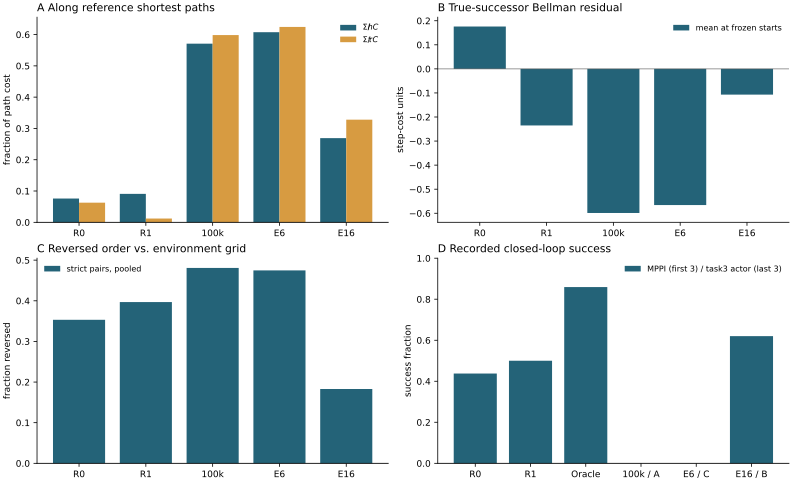
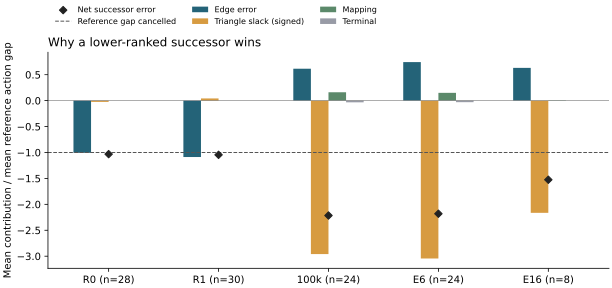

# U-trap 与 OGBench 的统一机制诊断

2026-11-02 · 固定 checkpoint 的只读分析

**两条线都出现了同一种决策失效：在同一状态、同一目标和同一批可执行动作上，critic 对不同后继的误差并不相同；这个差有时超过动作本来的成本间隔，使较差动作排在前面。** U-trap 的联通专家图上可以用已记录边上的精确最优值验证这一点。OGBench 上，绕开 actor 和潜在动力学、直接用原 100k critic 评价 MuJoCo 后继，仍在全部 50 个官方 task3 起点失败。证据足以定位到后继评分这一层。两条线的局部约束、采样分布和训练干预不同，现有对照不足以识别同一个训练根因。

| 同一批输入上的决策量 | U-trap R0 → R1 | OGBench 原 100k → E6 mean → E16 |
|---|---:|---:|
| 真后继相对参考的严格动作对反序率 | 专家图分支 34.6% → 31.1% | 50 个共同起点 48.1% → 47.5% → 18.3% |
| 最低评分动作未达到候选参考最优 | 28/58 → 30/58 个分支 | 24/50 → 24/50 → 8/50 个起点 |
| 冻结控制器实际成功 | MPPI 28/64 → 32/64 | 匹配提取 actor 在 task3 上 0/50 → 0/50 → 31/50 |

反序率汇总严格参考动作对，每个多分支源可贡献多对。第二行每个状态只投一票，衡量最终首选。两者方向可以不同。表中两列的环境、成本、候选和评价单位各异，不能合并为一个平均成功率。



图 A 的 U 列为全部图源各一条最短路径的等权平均，OG 列为同一条固定最短路线。图 B 为起点的一步残差，图 C 为 U 的十步 MPPI 序列、OG 的一步动作。图 D 的分母分别为 64 个配对回合和 50 个 task3 回合。

## 成本、目标和参考

- **U-trap。** 用原环境的正成本 (c=-r)。每物理步含时间 0.1、观测/通信短缺加权项（1、0.5）、观测失败 0.25、通信中断 1，碰撞或越界各罚 10。目标是同时满足观测与通信条件的合法姿态集合。编码器将合法终态归到同一任务目标，模型在此取零。离开 U 或绕墙只是途中阶段。碰撞会在原位结束回合；失败轨迹上最后一次物理观测的模型评分仍保留，不把它当作到达目标的零值。MPPI 对无效候选另加 (10^6) 搜索惩罚，该数不计入实际轨迹成本。
- **U 的两种参考。** 专家图含 307 条成功轨迹、42,536 条物理记录、6,958 条独特物理边、6,767 个 canonical 节点。全观测精确连接，终态按任务合并。排除 307 条非物理锚边，使用修订参考，唯一零点为 175；逐个非终节点复核了物理出边的 Bellman 等式。它精确回答已记录动作能走多便宜。图外使用独立 Hybrid A* 格点值，位置间距 0.25、24 个方向、5 步恒定控制 primitive、反向 Dijkstra。连续姿态查最近位置与方向，存在吸附并列和不可达格。这个参考只用于评分对照，连续最优值未知。[专家图审计](../connected_expert_utrap_20261021/main/audit/report.md) · [参考修订](../connected_reference_fix_20261024/main/report.md) · [MPPI 协议](../../experiments/r_series_mppi/PROTOCOL.md)
- **OGBench。** 仅 pointmaze-medium-navigate-v0，完整 critic 观测为二维位置。局部约束以一次真实控制步为 1，路径成本是步数。环境的稀疏成功奖励另行记录。网络学的是到点 (g) 的 (d(s,g))。实际任务在步后进入半径 1 的成功圆即完成，最多 1000 步。因此对原始点 critic 做三角分解时保留 (J_T=d(s_T,g))；评价到集合的一步备份时，进入成功圆的后继应改用 0。此次抽查的全部一步候选均在圆外，两种备份在这些状态相等。超时只截断记录。末状态续行重置时限，另作反事实。
- **OG 的两种图。** 独立环境参考按真实墙体、pointbody 半径 0.7、0.2 格点和无碰撞线段建立，各轴位移至多 0.2 的边计一步。0.2 图有 7,091 个自由节点、53,950 条有向边；按每个实际 goal 向成功圆内格点求最短路。实际候选由完整 MuJoCo integration state 生成，只有参考值查最近自由节点。格点不能表达所有接触状态、连续运动或动作。E16 的教师是训练数据派生的 6,302 原型 roadmap，含双向距离与多点连接先验。更早的有向数据转移图也经过 0.2 量化。两者均未用于本轮动作排序的裁判；旧数据图在固定 task3 的真实后继贪心仍为 0/5。[环境图与模拟器重放](../ogbench_critic_20261029/baseline_recheck/report.md) · [数据图对照](../ogbench_critic_20261029/data_graph_critic/report.md) · [E16 协议](../../experiments/ogbench_critic/HARD_GOAL_PROTOCOL.md)

## 1　单步违反的均值掩盖了什么

定义 (h=d(s,s')-c)。表中“正部”是全体样本的平均 max(h,0)，比例按 h > 0.0001 计。最大正违反与本表的最大有符号 h 相同。

| 边集（每模型样本数） | 模型 | 均值 | P95 | P99 | 最大 | 正部均值 | 违反比例 |
|---|---|---:|---:|---:|---:|---:|---:|
| U 物理记录（42,536） | R0 | −0.316 | 0.208 | 0.673 | 7.308 | 0.060 | 46.2% |
| 同上 | R1 | −0.305 | 0.371 | 1.090 | 8.251 | 0.096 | 47.6% |
| U 去重边（6,958） | R0 | −0.859 | 0.805 | 2.014 | 7.308 | 0.124 | 23.7% |
| 同上 | R1 | −0.786 | 1.276 | 2.945 | 8.251 | 0.215 | 29.9% |
| OG 验证集全部有效边（100,000） | 原 100k | 0.001 | 0.458 | 0.659 | 1.813 | 0.141 | 56.1% |
| 同上 | E6 mean | 0.001 | 0.472 | 0.689 | 1.939 | 0.143 | 55.7% |
| 同上 | E16 | −0.053 | 0.363 | 0.629 | 1.480 | 0.084 | 51.4% |

U 的共享后缀改变了记录权重。R1 的 P99 和最大违反均变大，图内路径额外成本却下降。OG 原模型的平均 h 几乎为零，在超过一半的验证边上仍有正违反。E16 的尾部较低，但其局部可行性也不完备。跨环境可比较正违反比例，以及相对一步成本的 h/c；OG 中 h/c=h。U 的完整两种加权分布见统一表。

## 2　误差如何沿路径累积

固定目标，定义每步三角松弛 τᵢ = d(sᵢ,sᵢ₊₁) + Jᵢ₊₁ − Jᵢ。对任意前缀都有

**J₀ − C = J末 + Σh − Στ。**

这里 C 是该前缀实际累计成本。仅当 C 来自对应参考的最短路时，左边才是相对该参考的距离误差。在单边上，沿该边的备份残差 (c+J'-J=τ-h)，多动作时对同一状态的候选取最小。归一化采用每条路径自己的 Σh/C、Στ/C 后再平均。14,116 条路径的每个前缀分别求边项和点值项，最大闭合误差 4.55×10⁻¹³。闭合验证了索引、符号和末项的一致性，不衡量预测精度。原网络前向为 FP32，所分析路径的最小 τ 为 −0.000165；未截去这些数值波动。

| 路径 | 模型 | C | J末 | Σh | 前半程 Στ | 全程 Στ | J₀−C | Σh/C，Στ/C |
|---|---|---:|---:|---:|---:|---:|---:|---|
| U 图最短，每个非终源一次（6,766） | R0 | 409.62 | 0 | 26.17 | 35.61 | 36.80 | −10.63 | 0.076，0.063 |
| 同上 | R1 | 409.62 | 0 | 31.89 | 5.26 | 6.30 | +25.59 | 0.091，0.012 |
| OG 固定环境图最短（同一条） | 原 100k | 60 | 4.55 | 34.26 | 34.57 | 35.91 | +2.90 | 0.571，0.598 |
| 同上 | E6 mean | 60 | 4.35 | 36.46 | 35.80 | 37.46 | +3.35 | 0.608，0.624 |
| 同上 | E16 | 60 | 5.86 | 16.14 | 11.24 | 19.68 | +2.32 | 0.269，0.328 |

U 的 R1 明显压低了沿专家最短路的松弛，平均误差从低估变为高估。OG 原模型在 60 步路线起点只高估 2.90 步，但两项各自已超过 34 步，且绝大部分松弛在前半段累积。历史搜索全部格点路线发现，该原 critic 从固定锚点出发至少要上坡 6.63 才能到达目标圆，E16 则有严格下降通道。起点标量看起来接近参考，无法保证途中能选择正确方向。[固定目标的路线与峰值](../ogbench_critic_20261029/baseline_recheck/report.md) · [E16 的下降通道](../ogbench_critic_20261029/hard_goal_1000/report.md)

两项对照说明适用范围。OG 同一条参考路线从真实锚点执行需 61 步，三模型的 Στ 分别为 36.18、37.71、20.41。另取 100 条验证轨迹各前 64 步，把第 64 步观测本身设为点目标，此时 J末=0，三模型的 Στ/C 却分别为 0.143、0.145、0.299。E16 的改善集中在与任务相关的路线，任意行为轨迹上的松弛并未普遍缩小。U 的成功 MPPI 轨迹上 R0/R1 的 J₀−C 平均为 +251.70/+309.16，碰撞轨迹的 J末 为 417.03/520.44；图上拟合的尺度直接带到连续访问分布，偏差很大。这些数是路径比较，成功集合在两模型间也不同。

## 3　直接评价真正能执行的后继

对合法候选集合 A，计算 b = minₐ[cₐ+J(s′ₐ,g)]−J(s,g)。b>0 表示最有利的候选也未实现模型声称的一步成本下降，b<0 表示至少一项下降超过该步成本。b≈0 只检验最低一项的一致性。表中归一化为每源 b 除以该源候选成本中位数，先逐源算再平均；OG 一步单位为 1。

| 输入与候选 | 模型 | b 均值 | P05，P95 | 归一化均值 |
|---|---|---:|---:|---:|
| U 6,766 非终源，全部物理出边 | R0 | 2.909 | −0.815，9.360 | 0.775 |
| 同上 | R1 | 1.291 | −1.295，6.167 | 0.343 |
| U 32 个连续起点，各 13 个等距角速度，逐个 env.step | R0 | 0.498 | −7.404，7.258 | 0.176 |
| 同上 | R1 | −0.617 | −7.731，7.452 | −0.235 |
| OG 50 个共同 task3 起点，各 121 个 MuJoCo 后继 | 原 100k | −0.599 | −1.236，0.124 | −0.599 |
| 同上 | E6 mean | −0.566 | −1.259，0.053 | −0.566 |
| 同上 | E16 | −0.107 | −0.762，0.537 | −0.107 |

U 图中只有 58 个源有多个不同后继。其余节点的 b 是唯一记录动作的残差，不能用来声称连续动作空间没有更好选择。连续 32 个起点的 416 个一步动作均合法，计算 b 时全部保留，排序时另排除 10 个 Oracle 格点不可达后继。OG 保留原 11×11 动作网格，包含零动作，从完整模拟器状态恢复；取网络最低评分的候选执行 env.step，所有抽查状态的后继与候选逐位一致。50 个起点在三个模型下都存在严格下降动作；原模型所选动作平均只推进 0.06 个参考格步，E16 为 0.70。真实后继上的错误排序已经绕过潜在动力学和 actor。

**提取链可另行测量。** 对同一个 121 动作集，按提取后的潜在动力学评分选动作，再用真实后继 critic 重评，减去真实网格最低分。50 个起点上该差依次为 0.270、0.255、0.039 步；实际连续 actor 动作做同样比较，依次为 0.325、0.269、0.970 步。连续 actor 动作可以落在格外，所以逐例的后一差值允许为负。E16 执行 20 步后，最终成功的 31 例中，两个差值平均为 0.007、0.242；最终超时的 19 例则为 0.331、1.022。此处分组已受 actor 访问状态影响，不能把两个差值相减当作 actor 和动力学的独立因果贡献。U 的正式 MPPI 直接使用已知动力学和真实环境闭环，没有待估计的潜在动力学或独立 actor 项。

## 4　哪一个误差翻转了动作，以及执行后发生了什么

记 V 为相应参考的剩余成本，e=J−V。令 a 为 critic 选中的动作，o 为同一候选集中参考总成本最低的动作。定义参考间隔 M=(cₐ+Vₐ)−(cₒ+Vₒ)，则模型间隔恰为 **M+(eₐ−eₒ)**。当 M>0 而模型间隔为负时，可以逐例指出后继误差差分如何盖过真实参考间隔。表中动作对比较排除参考差绝对值 ≤0.0001 的并列，模型并列另计。这里的“错选”指相对指定参考失去候选最优，连续环境不赋予它全局最优含义。

| 相同候选集 | 严格对反序率 | 错选状态数 | 参考第一与第二名间隔均值 | 模型第一与第二名间隔均值 | 错选时 M 中位数 | 错选时 eₐ−eₒ 中位数 |
|---|---:|---:|---:|---:|---:|---:|
| U 专家分支 R0 | 167/483 = 34.6% | 28/58 | 14.742 | 0.518 | 15.682 | −16.396 |
| U 专家分支 R1 | 150/483 = 31.1% | 30/58 | 14.742 | 0.535 | 6.394 | −9.802 |
| U MPPI 首次 H10 候选 R0 | 35.3% | 42/56 | 1.659 | 2.580 | 15.470 | −24.689 |
| U MPPI 首次 H10 候选 R1 | 39.7% | 42/56 | 1.659 | 1.933 | 15.474 | −26.171 |
| OG 起点原 100k | 48.1% | 24/50 | 0.020 | 0.125 | 2 | −4.279 |
| OG 起点 E6 mean | 47.5% | 24/50 | 0.020 | 0.123 | 2 | −4.264 |
| OG 起点 E16 | 18.3% | 8/50 | 0.020 | 0.056 | 2 | −2.818 |

每列中位数分别计算。U 新增的一步连续动作探针得到 R0/R1 反序率 42.4%/41.7%；其 0.1 步长运动在 0.25 位置格上很容易落到同格，仍可因朝向格或即时代价而区分。OG 起点 363,000 个动作对中，0.2 参考只有 218,301 对严格有序，其余并列。事后只改参考间距至 0.1、保持每步最大位移和同一 121 个真实后继，三组反序率为 48.0%/47.4%/18.3%，错选 24/24/7 个起点。仅取两种分辨率均严格同序的 171,812 对，反序率为 47.5%/46.9%/16.2%。两种图直接给出相反次序的有 198 对。0.2 主参考的后继最大吸附距离在起点为 0.139，包含接触附近的后续探针时达 0.195。绝对名次仍依赖离散化。[逐状态动作比较](action_order.csv) · [映射敏感性](resolution.csv)

### 在两个错选后继上分别追踪误差

以下均在上表相应模型的**错选状态**上取均值，差的方向均为“模型所选减参考所选”。U 沿修订参考的固定最短路，两个后继到同一零值目标，因此 Δe=ΔΣh−ΔΣτ。OG 从各真实后继吸附至 0.2 自由格，在最短路并列时沿编号最小的降一层邻点前进。另保留两个修正项，即真实后继与吸附节点的模型评分差 Δ映射，以及两个圆内终点的点目标评分差 Δ终点。每例都核对了四项之和与真实后继误差差分，累计 τ 项取负号。

| 范围 | 错选数 | M | Δ映射 | Δ终点 | ΔΣh | ΔΣτ | Δe | 模型间隔 |
|---|---:|---:|---:|---:|---:|---:|---:|---:|
| U R0 专家分支 | 28 | 22.16 | 0 | 0 | −22.32 | +0.55 | −22.87 | −0.70 |
| U R1 专家分支 | 30 | 18.13 | 0 | 0 | −19.72 | −0.77 | −18.95 | −0.82 |
| OG 原 100k 共同起点 | 24 | 1.96 | +0.32 | −0.06 | +1.20 | +5.80 | −4.34 | −2.38 |
| OG E6 mean 共同起点 | 24 | 1.96 | +0.29 | −0.06 | +1.45 | +5.96 | −4.27 | −2.31 |
| OG E16 共同起点 | 8 | 1.88 | +0.01 | 0 | +1.18 | +4.06 | −2.86 | −0.99 |

U 的错误分支平均呈现明显的累计有符号边误差差异。OG 的同类比较中，较差后继的后续图路径积累了更多三角松弛，把其预测剩余成本相对压低。即使两条最短路相对起点的距离都拟合尚可，两个后继之间很小的差仍可翻转。**两边直接共享的是相对评分失真；在本次固定参考和最短路选取下，翻转平均主要落在不同分解项。** 这些项随路径选择而变，合成的 Δe 在给定参考和动作对上确定。表中已按错选条件筛选，也不能从分项均值推出训练时哪项损失导致错误。[U 分支逐例分解](graph_attribution.csv) · [OG 起点逐例分解](og_grid_attribution.csv)



图中按每组错选样本的平均参考动作间隔归一化，各项可以相加。黑色菱形是净差分，低于 −1 即足以翻转该组的平均参考间隔。U 的负向贡献主要出现在边误差项，OG 主要出现在带负号的三角松弛项。

### U 的错误分支、逃逸和碰撞

图内按 c+J 贪心，R0→R1 的 165 个不同起点平均路径额外成本从 40.30 降至 29.74。虽然 R1 错选的分支多两个，但其错选分支平均损失从 22.16 降至 18.13。节点 0 给出可核查的例子：R0 选 5062，图最优后继为 5075；参考总成本差 +16.919，后继误差差分 −17.648，模型反而将 5062 评低 0.729。该专家图中所有分支均可通向终点，图内选错主要损失成本，不能直接推断会撞墙。[图内执行评价](../task_source_balance_20261025/main/comparison/report.md)

连续 MPPI 用 H=10、N=128、温度 1，对**整段累计成本加末态值**做指数加权，再执行加权第一动作。32 个相同起点、两个配对 planner seeds 的 64 个首决策均已复原；候选 hash 和末态一致，重算 R0/R1 和 Oracle 的首动作均在 10⁻⁶ 内。64 个 bank 中有 6 个全部候选无效，另 2 个虽有合法序列却无有限 Oracle 值，这 8 个在两模型和 Oracle 下最终都碰撞；它们保留在成功率与动作比较中。排序表只用余下 56 个 bank 内双方可比的合法序列。R0/R1 相对 Oracle 的实际首角速度绝对差在全部 64 例上平均为 0.592/0.614 rad/s。在可排序 bank 中，按最后结果分层，R0 成功/碰撞组的首决策反序率为 29.5%/42.3%，R1 为 37.5%/43.5%。

| 控制器 | 全部成功 | U 内成功 | 西出口成功 | 碰撞 |
|---|---:|---:|---:|---:|
| 无终值 | 6/64 | 4/48 | 2/16 | 58 |
| R0 | 28/64 | 12/48 | 16/16 | 36 |
| R1 | 32/64 | 16/48 | 16/16 | 32 |
| 格点 Oracle | 55/64 | 39/48 | 16/16 | 9 |

模型组的失败都发生在离开 U 之前。配对的净增 4 例来自 inside_09、inside_23 各两个 planner seed；共同成功的 28 例中，R1 的实际成本平均还高 2.17。首个 argmin 不能解释整段轨迹。例如 inside_23、seed 314159 上，R0 的首选序列与 Oracle 参考并列最优却最终碰撞；R1 的首选参考额外成本为 21.30，却成功绕出。其实际加权首动作从 +0.082 变为 −0.212 rad/s（Oracle −0.401）。因此有直接证据表明终值改变了动作和配对成功，但不能把 4 次改善归因于首轮排序变好，或把所有碰撞归因于 critic。[配对 MPPI 全结果](../r_series_mppi_20261026/main/comparison/report.md)

### OGBench 的停滞与残余提取误差

| 冻结 critic / 对应提取 | 既有 25 例真实后继贪心 | 25 例中的直接提取 actor | 官方 actor 各任务成功数（每项 /50） | 同 50 个官方 task3 起点真实后继贪心 |
|---|---:|---:|---|---:|
| 原 100k / E17-A | 16/25 | 20/25 | 50，50，0，50，50 | 0/50 |
| E6 mean / E18-C | 16/25 | 20/25 | 50，50，0，50，50 | 历史未测 |
| E16 / E17-B | 25/25 | 23/25 | 50，50，31，50，50 | 42/50 |

直接读取了 E17/E18 的全部 750 个官方 actor 回合，逐个核对三组的 250 对初始观测和目标；未重跑提取或正式评价。既有 25 例曾用于方法选择，不能当作独立验证。50 个官方 task3 的正式匹配流与它分开。E6/E16 在原 100k 后各做了 1000 次价值更新，之后动力学、actor 各做 1000 次相同批次的提取更新。B 相对 C 的 31 个新增成功无反向损失，其他 200 个成功全部保留，因此“多 1000 次普通价值更新”解释不了此流上的差距。E16 同时使用教师、改变查询与目标选择，前向开销、λ 处理不同，现有比较没有单独识别其中一项。[E17](../ogbench_critic_20261029/extraction_1000/report.md) · [E18 等更新对照](../ogbench_critic_20261029/mean_extraction_1000/report.md)

停滞可直接从坐标读出。每个超时 actor 回合取最后 100 个观测的 x、y 各自极差，再取两轴最大值。A、C 各 50 个超时的这一值全部低于 0.000002；B 剩下的 19 个超时也全部小于 0.05（一步各轴可走 0.2）。这是留在局部或小幅振荡，不是 U-trap 那样的碰撞终止。

复用同起点、同目标的真实后继反事实，在 19 个 B-actor 失败例中，8 例 E16 贪心从原起点和失败末态均不能成功，2 例从原起点能成功、从 actor 到达的末态不能成功，9 例从两处均能成功。后 9 例直接证明这些末态的 critic 仍可被另一控制器利用；前 10 例保留了状态访问、评分及有限候选控制的限制。B 的正式 task3 成绩始终是 31/50，续行的 9 次不能计入。原 100k 贪心 0/50 与 E16 42/50 的差异，则在完全绕开 actor 与潜在动力学后仍存在。[50 个起点与 19 个末态反事实](../ogbench_critic_20261029/official_counterfactual_completion/report.md)

## 共同机制的证据边界与最小辨因实验

**直接证据。** 两条线在真实一步后继上均存在超出候选动作间隔的差分评分误差。U 有图内精确分支分解、连续首控制量重放、同规划器换终值的闭环差异；OG 有不同分辨率的环境参考、同物理后继换 critic 的闭环反事实、匹配更新与匹配输入的提取评价。局部均值、整体距离精度、单一起点的 b，都不足以判定这些相对次序。有限控制预算也会造成失败，即便采用较可信参考或改进 critic。

**仍待验证的训练解释。** 一个可检验的假设是，训练批次对决定分支的“两个后继到同一目标”的相对误差给出的纠正信号，弱于平均推远或其他目标的影响。U 的历史证据显示新增违反多来自低副本边，却未在分支三跳邻域额外富集；不能仅按地理位置归因。OG 原 100k 的单走廊梯度审计发现推远项会加剧所测上坡，局部项提供反向作用；联合损失中动力学项在那个 probe 的单步影响很小。这两项审计的目标、probe 和采样单位均不同。现有结果没有证明同一个乘子滞后、同一种样本不足、同一个损失项或同一种三角松弛导致了两条线的训练结果。[U 的曝光与乘子审计](../constraint_exposure_diagnostic_20261026/verified/report.md) · [OG 的固定批次梯度审计](../ogbench_critic_20261029/mechanism_gradient/report.md) · [联合梯度复核](../ogbench_critic_20261029/full_gradient_fp32/report.md)

**最小下一步可以不更新参数。** 在已有 R0 和原 100k checkpoint 上，各固定本报告已列出的分支/起点、候选、目标和参考。只用参考严格排序的动作对，OG 另要求两种格点同序。对每源取“参考最优与最接近的严格次优”，并按参考间隔和后继支持度配对比较判对/判错的样本。固定重放同一组历史 sampler 批次（例如各取既有流前 32 批），对相对评分差的梯度分别与原推远项、局部项、适用的动力学项做内积，同时记录采样次数和局部项激活率；U 使用原逐记录 PHR 乘子，OG 使用原 λ。比较原权重和仅在离线求和时按源等权的投影，始终不写参数或优化器。若纠正投影在低支持错对上稀少而等权后恢复，支持曝光不足；若两边同批次都有明显纠正梯度却被推远项抵消，支持目标冲突；若两边模式不同，则应分别追查其训练成因。没有同时匹配支持度和间隔的样本须列为空缺。该实验仅能辨别冻结点附近的压力，训练历史的因果判断仍需要独立干预。

## 模型、范围与复现

所有原始输入来自已存在的历史工作树，本工作树版本为 `21db0484f701a9495e9e3dd605b0d7bb244e2598`。下表列固定端点的 SHA-256 前 12 位，完整路径、SHA-256 和官方数据文件标识见输入清单。OG 官方源码固定为 `a977253ce5b88434f4e4f531c50047cc95993a51`。每个提取终点的 value 参数树都与对应源 checkpoint 逐叶相等。

| 用途 | 训练/固定端点 | SHA-256 前缀 |
|---|---|---|
| U R0、R1 | seed606，共同联通专家 replay，50k；R0 按物理记录，R1 仅 task push 按去重源重权 | 4225998ede46，6751085907c4 |
| OG 100k、E6 mean、E16 | seed0 官方 navigate 100k；mean 普通续训 1k；hard_goal 固定 1k | 397e919f2c45，d92cf664f103，71a8d61900ac |
| OG E17-A、E18-C、E17-B | 分阶段提取后的 actor 终点，Adam 计数 102000、103000、103000 | 0f0c1fc98bb1，8219d3c77c62，dbec9e4ad128 |

U 连续测试限同一任务 32 个地理起点及两个 planner seeds（314159、271828），两个 seed 共用地理起点。OG 为一个训练初始化、五项 navigate 任务；验证集 100 条轨迹、100,000 个有效转移，训练集 1,000 条、1,000,000 个有效转移。训练/验证 compact 文件各另有 1,000/100 个无效末行，不作源，不跨 episode。训练集在本轮仅核验身份并通过官方加载器读取。候选检查集中在最困难的 task3；没有据此推断其他环境、初始化或完整 1M 预算的效果。[U 输入](u/inputs.json) · [OG 输入](og/inputs.json) · [完整核验记录](audit.json)

从当前仓库根目录执行以下命令。输出目录须全新。两个运行时分别使用原 Torch 和固定官方 JAX/MuJoCo 环境；可用 U_PY、OG_PY 指定等价解释器。raw 指向含原始权重、数据、官方 vendor、缓存和轨迹的历史工作树，只有提交版报告的目录不够。新脚本只读历史产物，Oracle 缓存从临时副本加载。本轮训练更新数为零。在全新目录从头运行同一入口后，13 份数值 CSV 和审计 JSON 均逐字节一致。[复现校验](reproduction.json)

```bash
raw="$HOME/.codex/worktrees/5670/quasimetric-rl-topology-improvements"
bash experiments/unified_mechanism/run.sh "$raw" results/unified_mechanism_reproduction
```

[冻结设计与事后检查说明](../../experiments/unified_mechanism/PROTOCOL.md) · [可复现入口](../../experiments/unified_mechanism/run.sh) · [统一指标长表](unified_metrics.csv) · [动作间隔与反序](action_order.csv) · [全部任务成功计数](outcomes.csv)

统一表按 scene、model、scope、metric 区分统计总体，列出 n、均值、分位数、最大值与正负比例。action_order 按严格候选对加权，并单列逐源统计；不把同一状态的大量动作对当作独立回合。作为审计底稿，[U 路径](u/paths.csv)、[U 决策](u/decisions.csv)、[OG 路径](og/paths.csv)、[OG 决策](og/decisions.csv) 和 [OG 官方样本索引](og/official.csv) 均按模型与状态/回合保留。
