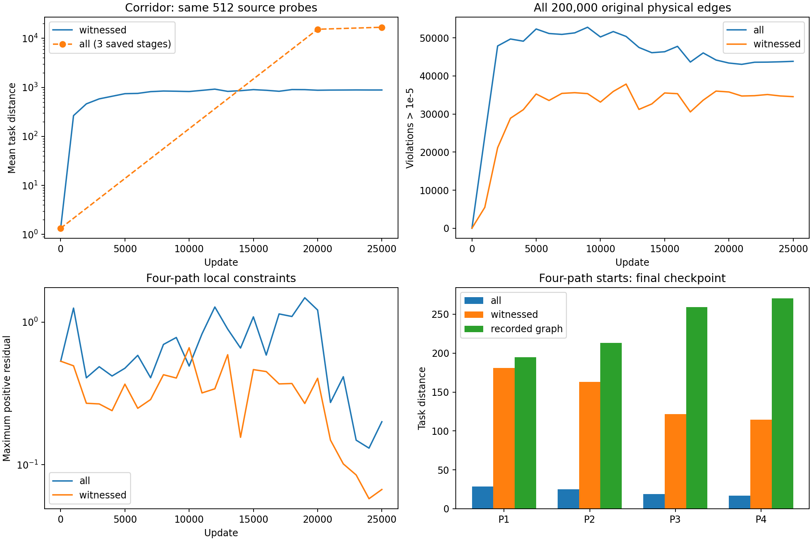
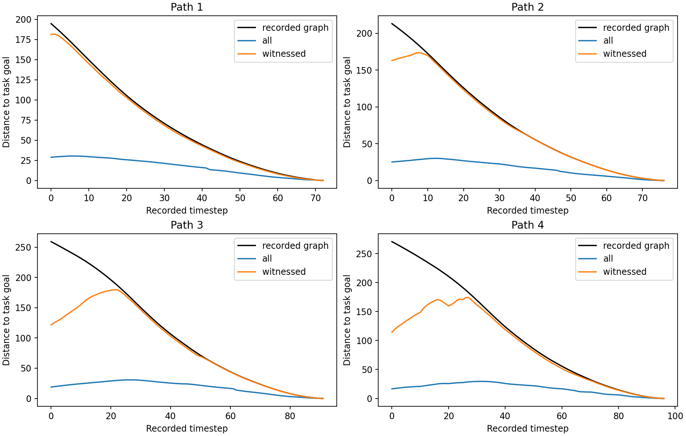

# Witnessed task push：单 seed 配对诊断

保持完整 20 万转移＋四路径、共享 encoder/IQE、采样、局部 PHR、B1 和学习率预算不变，仅 task push 选择真实合法成功后缀的源。seed 606 从与旧 all 实验逐位相同的初始参数重新训练，固定完成 20,000＋5,000 步；没有按参考值选择模型。

三个问题的判断：

1. **此前的大幅数值膨胀受到抑制，但不能说完全停止增长。** corridor 最终全量均值下降 94.66%，探针后半段呈平台附近波动，降步长阶段变化 +1.16%。没有记录成功链，因此不能把最终较小预测解释为正确任务距离。
2. **四路径距离量级明显回升，但长程起点仍不完整。** NRMSE 从 85.35% 降到 27.36%；P1 接近参考，P3/P4 起点仍大幅低估。整体平均误差改善不能掩盖这些前段失败。
3. **约束违反幅度明显缓解，尚未恢复全量可行性。** 原始边的违反数量、最大值和平均正残差均下降；四路径最大值和平均正残差下降，但违反边数增加，入终态边的部分指标也恶化。

| 指标 | 原 all task | witnessed task |
|---|---:|---:|
| corridor 全 50,000 源的 task 均值 | 16869.6387 | 901.1869 |
| 四路径 task NRMSE | 85.354% | 27.357% |
| 四路径 push gap | 72.972% | 15.268% |
| 原始边违反数（>1e-5） | 43845/200000 | 34566/200000 |
| 原始边最大正残差 | 171.253 | 90.4281 |
| 原始边平均正残差 | 0.932728 | 0.217276 |
| 四路径边违反数（>1e-5） | 43/335 | 76/335 |
| 四路径边最大正残差 | 0.200007 | 0.0669125 |
| 四路径边平均正残差 | 0.00607408 | 0.00260921 |

corridor 最终均值为旧 all 的 5.342%。同一组 512 探针均值：初始化 1.339 → PHR 结束 874.490 → 最终 884.662；降步长阶段变化 +1.163%。其记录图到任务终态仍无有限路径，较小数值本身不是正确估值的证据。共享模型受其他 task 与 B1 更新影响，即使没有直接 task push，corridor 值也可以变化。旧 all 实验只有 initial/PHR/final 三个可恢复阶段，图中虚线仅连接这些阶段。

| 路径起点 | all | witnessed | 记录图参考 | edge slack | triangle slack |
|---|---:|---:|---:|---:|---:|
| P1 | 28.791 | 181.169 | 194.489 | 4.979 | 8.341 |
| P2 | 25.084 | 163.008 | 213.116 | 10.594 | 39.515 |
| P3 | 18.891 | 121.559 | 259.063 | 16.105 | 121.399 |
| P4 | 16.636 | 114.401 | 270.548 | 25.395 | 130.752 |

edge slack 是路径一步成本与预测边长之差的累加；triangle slack 是预测边长与相邻 task 值间的三角不等式余量。两者之和为起点低估。局部可行性、记录图长程恢复和未见状态导航是不同指标；不以约束数或 push gap 单独判断成功。
P3/P4 起点分别低估 53.1%/57.7%；其中三角余量占起点低估的 88.3%/83.7%。路径曲线前段沿真实成功路径前进时预测 task 距离反而升高，后段才贴近参考。这是剩余长程关系未恢复的直接证据；不能由后段拟合较好推断候选排序或闭环成功。

## 各任务与片段支持

| 原始任务 | task 见证源 | task 均值 all → witnessed | B1 均值 all → witnessed | 超出 B1 记录片段上界 all → witnessed |
|---|---:|---:|---:|---:|
| device 0 | 370/50000 | 40.14 → 247.40 | 84.91 → 102.26 | 2924 → 1764 |
| device 1 | 0/50000 | 16869.64 → 901.19 | 154.58 → 174.48 | 2421 → 833 |
| device 2 | 1373/50000 | 921.79 → 672.71 | 119.92 → 134.49 | 4216 → 3180 |
| device 3 | 832/50000 | 1467.37 → 635.67 | 143.59 → 142.15 | 4539 → 2706 |

原始真实入终态边共 14 条：违反数 12 → 13，最大正残差 171.2531 → 90.4281。这些边与恒等 anchor 分开统计，不能用 anchor 为零掩盖入终态边违反。
四路径入终态边的违反数 2 → 3，最大正残差 0.022325 → 0.066913。局部改善并非每一个子组都成立。
B1 的有记录片段成本只是该对状态的距离上界，不自动等于最短距离。上表是所有记录源的预测均值，并非 witnessed 训练目标；没有见证的 task 预测仍可在评估中读取，但不会被 task loss 最大化。

## 掩码、数据与更新保留

原始 task 保留 2,575/200,000 个见证源，四路径保留 335/335；每步两个来源各占 0.5，内部 task 0.6、B1 0.4。task 对当前来源 batch 中保留条目求均值，空选择返回可微零；不回退到全 task，也不把空项权重交给 B1。条件均值会把原 task 权重集中到见证源，这与生产 witnessed 语义一致，并非用 200,000 作固定分母。
原始空 task batch 共 877/25,000（3.51%）。所有原始物理边访问 31–32 次；原始 B1 总访问 6,394,048，四路径 B1 总访问 8,375,000。采样器最终状态和逐边访问数与旧实验逐位一致。失败片段未从约束或 B1 删除。

独立核验确认完整成本、动力学、终态 anchor 和 B1 episode 边界正确；模型初始参数、最终采样器状态及逐边访问数与旧实验逐位一致，合并数据、成本及配对指纹一致，旧结果哈希未变。另抽取2,048个配对检查推理适配，最大输出差为0。所有 201,087 边每 1,000 步扫描；752 个 quotient 恒等 anchor 保持零，原始物理边的乘子仍只按访问更新，四路径每步更新，没有加入 QP。

剩余瓶颈至少有两项：原始边每条只访问 31–32 次，特别是 14 条入终态边仍有大残差；四路径前段则主要缺少长程距离的紧致性，不能只靠进一步压低局部违反来保证恢复。当前数据支持限制消除了一个明显的无见证最大化方向，但没有解决这两项问题。本实验未改变采样或优化器来进一步验证其因果作用。

## 解释范围与复现

这是单个配对 seed 的训练目标诊断，不是跨 seed 稳健性结论。本轮未新增闭环 MPPI 或固定候选评估，因此不能据此宣称未见状态或导航成功率改善；此前 all 模型的闭环失败结果保留。所有残差、最坏 50 边、各任务预测分布及 B1 上界违反均输出，没有筛掉失败。图参考及 B1 链成本仅用于固定最终 checkpoint 的事后评估；无 Oracle 标签，无新采集。

数值限制：生产实现的 4 CPU 线程更新存在微小非确定性。相同初始状态及 batch 的两份模型，5 步后最大参数差约 2.16e-5；单线程同样检查逐位相同。端到端恢复 smoke 的访问计数一致，但浮点模型轨迹不保证逐位相同。本轮正式训练未中断恢复，并维持旧 4 线程设置；配对初始化和采样消除了这两项差异，但未消除多线程数值噪声。

复现入口：[实验说明与运行命令](../../../../experiments/witnessed_task_push/README.md)。checkpoint 含模型、AdamW、所有逐边乘子、访问计数、采样器及 RNG，并校验 task mode/mask，防止跨目标误恢复。

